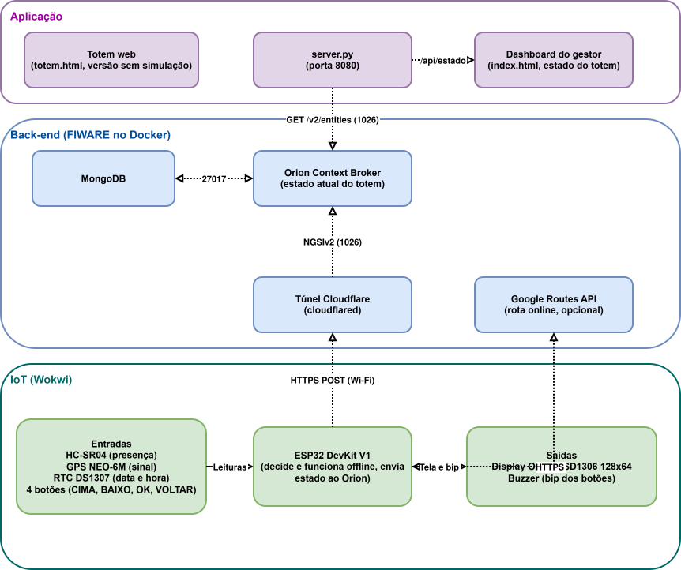

# ApoiaSP

Totem de apoio ao cidadão (ESP32 + Wokwi) - Global Solution - Edge Computing & Computer Systems - FIAP.

O totem usado como base para a demonstração do projeto fica localizado próximo a estação de metrô Trianon-Masp, Av. Paulista, e indica, mesmo sem internet, o serviço público mais próximo (saúde, segurança, documentos e assistência social). Mostra a rota a pé no display e gera um QR code para levar o caminho no celular, disponibilizando essas informações em 3 idiomas (PT, ES, EN).

Quando há rede, envia seu estado ao **FIWARE Orion**, e um dashboard web exibe o que aparece na tela do totem.


ESP32 (Wokwi) -> Túnel Cloudflare -> Orion (Docker) -> server.py -> Dashboard


## Integrantes

- Laura de Siqueira Silva - RM573796 
- Lavínia Tavares Apolinário Dantas - RM: 574172
- Vitória Valentim de Melo Ferreira - RM570502
- Yannick Dávila Parreira - RM572443
- Yasmin Siunte Gregório - RM569867

## Peças do projeto Wokwi

- ESP32 DevKit V1| Microcontrolador
- Display OLED SSD1306 128x64 (I2C, 0x3C)
- RTC DS1307
- Sensor ultrassônico HC-SR04 
- GPS NEO-6M (chip customizado)
- Buzzer | Bip ao apertar botões
- 4 botões (CIMA, BAIXO, OK, VOLTAR)

Bibliotecas: Adafruit GFX, Adafruit SSD1306, RTClib, TinyGPSPlus e ArduinoJson.

## Arquitetura



## Passo a passo

**Pré-requisitos:** Docker, Python 3, `cloudflared` e conta gratuita no [Wokwi](https://wokwi.com/projects/480976924614735873).

**1. Suba o Orion**

Crie um `docker-compose.yml`:

```yaml
services:
  mongo-db:
    image: mongo:4.4
    command: --nojournal
  orion:
    image: fiware/orion
    ports:
      - "1026:1026"
    depends_on:
      - mongo-db
    command: -dbhost mongo-db
```

```bash
docker compose up -d
curl http://localhost:1026/version
```

**2. Abra o túnel** (para o Wokwi alcançar o Orion do seu PC) e copie a URL `https://....trycloudflare.com`:

```bash
cloudflared tunnel --url http://localhost:1026
```

A URL muda a cada reinício do cloudflared.

**3. Monte o projeto no Wokwi**

1. Crie um projeto **ESP32** e copie os arquivos da pasta `Wokwi/` (`sketch.ino`, `diagram.json`, `libraries.txt`, `qrcode.c`, `qrcode.h`, `gps-neo6m.chip.json`, `gps-neo6m.chip.c`), projeto que pode ser visualizado no próprio [Wokwi](https://wokwi.com/projects/480976924614735873).
2. No `sketch.ino`, cole a URL do túnel, sem `/` no final:

```cpp
const char* FIWARE_ENDPOINT = "https://SUA-URL.trycloudflare.com";
```

3. (Opcional) Para rotas online, preencha `GOOGLE_MAPS_API_KEY`. Sem chave, o totem usa as rotas offline salvas no código.

**4. Inicie o dashboard**, dentro de `dashboard-site/`:

```bash
python server.py
```

Abra **http://localhost:8080**. Não abra o `index.html` com duplo clique.

**5. Rode a simulação** no Wokwi (botão Play). Quando o Serial Monitor mostrar `FIWARE HTTP: 204`, o painel passa para "Dados ao vivo".


## Como usar o totem

| Ação | Resultado |
|---|---|
| Aproximar do sensor (ultrassônico) (< 150 cm) ou apertar um botão | Liga a tela |
| CIMA / BAIXO | Navega nos menus |
| OK | Escolhe a opção |
| VOLTAR | Volta à tela anterior |
| No resultado, OK | Escolhe "Passos na tela", "QR Google Maps" ou "QR passo a passo" |
| 30 s sem ninguém por perto | Tela desliga |

---

## Problemas comuns

| Serial Monitor | Causa |
|---|---|
| `FIWARE HTTP: 204` | Tudo certo |
| `Wi-Fi sem conexao` | Reinicie a simulação ou desligue VPN/bloqueador de anúncios |
| `FIWARE HTTP: -1` | URL do túnel errada/desatualizada, ou túnel/Orion fora do ar |
| `FIWARE HTTP: 400` | Orion recusou o conteúdo (veja o motivo no Serial) |

Painel mostrando "Totem sem sinal": a simulação está parada (mais de 60 s sem dados).


## Links externos

- [Wokwi](https://wokwi.com/projects/480976924614735873)
- [Youtube](https://youtu.be/JorJLzGjLvE)


